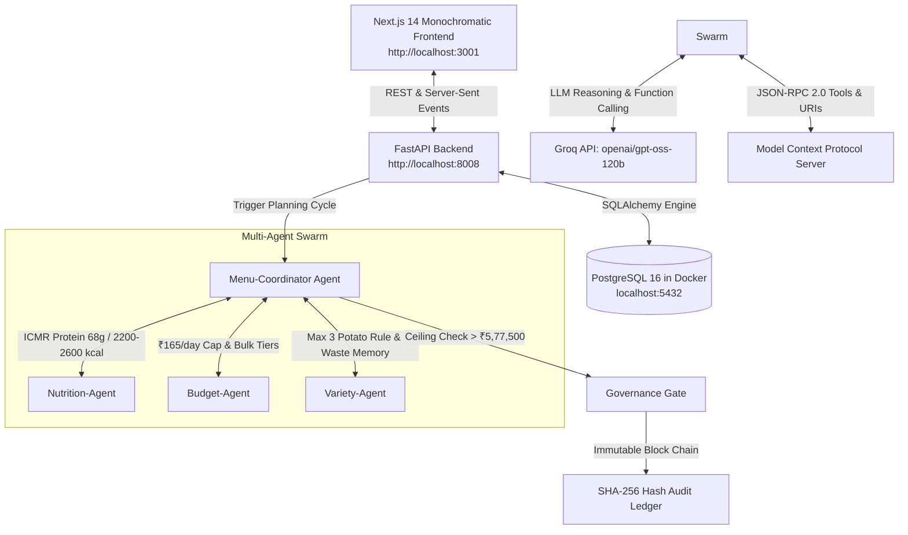

# Hostel Mess Operations Agent (`agentic-hostel-mess`)
## Complete System Walkthrough, Architecture & Operations Guide

> **Project 3**: A standing autonomous operations agent that plans the university hostel's weekly menu, watches wholesale APMC Mandi budgets, prioritizes expiring pantry stock, and learns from student consumption patterns — running cyclically every week of the semester.

---

## 📋 Table of Contents
1. [System Architecture Overview](#1-system-architecture-overview)
2. [Commands to Start the Project](#2-commands-to-start-the-project)
3. [Commands to Stop the Project](#3-commands-to-stop-the-project)
4. [One-Click Start & Stop Scripts](#4-one-click-start--stop-scripts)
5. [Page-by-Page Feature Walkthrough & Demo Script](#5-page-by-page-feature-walkthrough--demo-script)
6. [API & MCP Protocol Reference](#6-api--mcp-protocol-reference)
7. [Troubleshooting & Verification](#7-troubleshooting--verification)

---

## 1. System Architecture Overview



### Key Technology Stack:
- **LLM Engine**: Groq API (`openai/gpt-oss-120b` / `llama-3.3-70b-versatile`).
- **Database**: Containerized PostgreSQL 16 Alpine (`agentic-mess-db`).
- **Backend API**: Python FastAPI with REST and SSE streaming (`uvicorn`).
- **MCP Server**: Model Context Protocol JSON-RPC 2.0 (`mess://vendor-prices`, `mess://inventory`).
- **Frontend**: Next.js 14, React 18, Tailwind CSS, Lucide Icons, Framer Motion.

---

## 2. Commands to Start the Project

### Step 1: Start the PostgreSQL Docker Container
```bash
docker compose up -d
```
*Verifies: Starts `agentic-mess-db` on port `5432` with seeded inventory and wholesale price catalog.*

### Step 2: Start the FastAPI Backend Server (Port 8008)
```bash
python3 -m uvicorn src.api:app --host 0.0.0.0 --port 8008
```
*Verifies: Starts REST and SSE streaming endpoints at `http://localhost:8008` (Interactive docs at `http://localhost:8008/docs`).*

### Step 3: Start the Next.js Frontend (Port 3001)
```bash
cd frontend
npx next start -p 3001
# Or for development mode:
# npm run dev
```
*Verifies: Starts the web UI at `http://localhost:3001`.*

---

## 3. Commands to Stop the Project

### Stop Frontend and Backend Processes
```bash
# Stop FastAPI backend
pkill -f "uvicorn src.api:app"

# Stop Next.js server
pkill -f "next start" || pkill -f "next dev"
```

### Stop the PostgreSQL Docker Container
```bash
# Stop container and preserve database data
docker compose stop

# Or stop and remove container (keeps database volume)
docker compose down
```

---

## 4. One-Click Start & Stop Scripts

For convenience, you can run the pre-built shell scripts:

### To Start Everything:
```bash
./start.sh
```

### To Stop Everything:
```bash
./stop.sh
```

---

## 5. Page-by-Page Feature Walkthrough & Demo Script

### 🏠 1. Hero Landing Page (`http://localhost:3001/`)
- **What it shows**: Standing operations mission overview, key weekly metrics (₹443,091 Requisition, ₹126.60/student daily rate, 74.2g average protein, 107kg leftovers cleared), and quick-launch module buttons.
- **Demo Talking Point**: *"This is not a one-shot prompt generator. It is a standing operations system running every week of the semester to balance ICMR nutrition standards, Mandi wholesale pricing, and pantry waste."*

---

### 🐝 2. Swarm Debate & Real-Time Stream (`http://localhost:3001/swarm`)
- **What it shows**: The 4 specialized agents evaluating the candidate menu concurrently:
  - **Nutrition-Agent**: Audits protein floor (68g) and calories (2,200–2,600 kcal).
  - **Budget-Agent**: Audits ₹165/student/day rate and wholesale discount tiers.
  - **Variety-Agent**: Enforces Max 3 Potato rule, Max 2 Paneer rule, and plate-waste penalties.
  - **Menu-Coordinator**: Enforces Leftover-First rule and resolves conflicts.
- **Interactive Action**: Click **"Stream Routine Swarm (Wk 6)"** or **"Stream Breach Swarm (Wk 8)"**.
- **Visual Highlight**: Watch the live **SSE Event Feed** with explicit **`MCP: mess://inventory`** and **`MCP: mess://vendor-prices`** tags.
- **Conflict Arbitrations**:
  - **Potato Repetition Conflict**: Budget-Agent picked Aloo Paratha (4th potato dish). Variety-Agent vetoed it. Coordinator swapped it to Moong Dal Cheela (+6.7g protein).
  - **Kadhi Pakoda Waste Conflict**: Flagged for 31.5% historical waste and protein deficit. Coordinator replaced it with Rajma Masala (+14.2g protein).

---

### 🍱 3. 7-Day Menu Matrix (`http://localhost:3001/menu`)
- **What it shows**: Full 7-day schedule across 4 meal slots (Breakfast, Lunch, Snacks, Dinner) with calibrated portion macros.
- **Interactive Action**: Click **"Run Routine Cycle (Wk 6)"** to trigger dynamic Groq LLM planning.
- **Visual Highlight**:
  - Click on **Monday**: Notice the green badge **"Leftover Prioritized: Cauliflower (35kg), Hybrid Tomatoes (20kg)"**.
  - Review daily calories, protein, and plate cost badges.

---

### 🛡️ 4. Governance & Human-in-the-Loop Approval Gate (`http://localhost:3001/governance`)
- **What it shows**: Human-in-the-Loop safety gate for orders exceeding the weekly budget allowance (₹5,77,500.00).
- **Interactive Action**:
  1. Shows the active incident: **Diwali Festive Feast (Week 8)** at **₹634,409.16** (+₹56,909.16 over ceiling).
  2. Click **"Authorize Requisition"** on **Student General Secretary** and **Mess Warden**.
  3. Status immediately updates to **"QUORUM REACHED - APPROVED"** (2 of 3 votes).
  4. Appends a new cryptographic block to the **SHA-256 Immutable Audit Ledger** below.

---

### 📦 5. Live Pantry Inventory (`http://localhost:3001/pantry`)
- **What it shows**: Real-time PostgreSQL stock tracker showing lot numbers, batch IDs, and shelf-life countdowns.
- **Interactive Action**:
  - Click **"Filter Expiring Only"** to show items $\le 3\text{ days}$ that triggered the Leftover-First rule.
  - Click **`+`** / **`-`** buttons to adjust stock in PostgreSQL in real time.

---

### 🔌 6. Model Context Protocol (MCP) Console (`http://localhost:3001/mcp`)
- **What it shows**: Official Model Context Protocol explorer and JSON-RPC 2.0 console.
- **Tabs**:
  1. **Discoverable Tools**: `vendor_price_list`, `inventory_table`, `mock_ordering_api`.
  2. **MCP Resources**: Live URI explorer for `mess://vendor-prices` and `mess://inventory`. Click **"resources/read"** to fetch raw JSON payloads.
  3. **JSON-RPC 2.0 Terminal**: Select pre-built RPC templates (`initialize`, `tools/list`, `tools/call`) and transmit raw JSON-RPC frames.

---

### 📚 7. System Deliverables & Specs (`http://localhost:3001/docs`)
- **What it shows**: Browser for all 8 project deliverables:
  1. `docs/node_graph.md`: Architecture flowchart.
  2. `skills/weekly_menu_planning.md`: Packaged skill specification.
  3. `docs/memory_schema.md`: Dual-tier session state & LTM schema.
  4. `docs/tool_list.md`: Operational tool contracts.
  5. `docs/prompt_log.md`: Swarm agent prompts & loss functions.
  6. `docs/execution_trace.md`: Semester cycle turn-by-turn trace.
  7. `docs/budget_breach_case.md`: Diwali banquet case study.
  8. `docs/limitations_note.md`: Technical & operational bounds.

---

## 6. API & MCP Protocol Reference

| Method | Endpoint | Description |
|---|---|---|
| `GET` | `/api/health` | Service health, PostgreSQL container & Groq LLM status |
| `GET` | `/api/menu/latest` | Fetch the latest persisted 7-day menu matrix |
| `POST` | `/api/agents/generate-plan` | Run multi-agent planning cycle with Groq LLM |
| `GET` | `/api/agents/stream-cycle` | Server-Sent Events (SSE) live multi-agent debate stream |
| `GET` | `/api/inventory` | List PostgreSQL pantry stock with expiration filters |
| `POST` | `/api/inventory/update` | Adjust item quantity in PostgreSQL |
| `GET` | `/api/governance/status` | Active approval cases & SHA-256 hash chain |
| `POST` | `/api/governance/sign` | Submit committee vote & record cryptographic hash |
| `POST` | `/api/mcp/rpc` | Standard JSON-RPC 2.0 Model Context Protocol endpoint |
| `GET` | `/api/mcp/resources` | List discoverable MCP tools & URI resources |

---

## 7. Troubleshooting & Verification

- **Verify Database**: `docker ps` should show `agentic-mess-db` running and healthy.
- **Verify Backend**: `curl -s http://localhost:8008/api/health` should return `{"status": "healthy"}`.
- **Verify Frontend**: Open `http://localhost:3001` in your browser.
