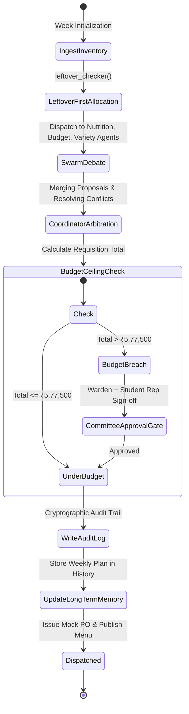

# Dual-Tier Memory System Specification

The Hostel Mess Operations Agent employs a strict separation between **ephemeral Session State** and **durable Long-Term Memory (LTM)**.

---

## 1. Architectural Philosophy

| Dimension | Tier 1: Session State (Working Memory) | Tier 2: Long-Term Memory (Semantic & Episodic) |
|---|---|---|
| **Scope** | Current week's planning iteration (e.g., Week 6) | Full semester and multi-semester history (Weeks 1 to 16) |
| **Persistence** | Ephemeral, reset after weekly order dispatch | Durable JSON/Vector store |
| **Latency** | In-memory RAM / Redis / Fast Context | Key-Value & Relational/Document DB |
| **Purpose** | Draft negotiation, scratchpad, agent debate diffs | Learning from plate waste, complaints, ratings |
| **Mutability** | Highly mutable during swarm deliberation | Append-only / aggregated rolling averages |

---

## 2. Session State Schema (Active Week Draft)

```json
{
  "cycle_id": "CYCLE-2026-W06",
  "semester_week": 6,
  "planning_stage": "ARBITRATING_CONFLICTS",
  "draft_revision": 3,
  "current_draft": {
    "Monday": { "breakfast": "Poha", "lunch": "Aloo Gobi Matar", "snack": "Bread Pakoda", "dinner": "Palak Paneer" }
  },
  "active_conflicts": [
    {
      "conflict_id": "CONF-06-01",
      "agents_involved": ["Budget-Agent", "Variety-Agent"],
      "description": "Budget-Agent proposed Aloo Sabzi 4 times. Variety-Agent rejected (max 3 potato meals).",
      "resolution": "Coordinator substituted Tuesday Lunch Aloo Sabzi with Rajma Masala using surplus dry kidney beans.",
      "status": "RESOLVED"
    }
  ],
  "leftovers_allocated": [
    { "item": "Hybrid Tomatoes", "quantity_kg": 48.0, "assigned_meal": "Monday Lunch" },
    { "item": "Fresh Spinach (Palak)", "quantity_kg": 24.0, "assigned_meal": "Monday Dinner" }
  ],
  "running_cost_estimate_inr": 542300.00
}
```

---

## 3. Long-Term Memory Schema (Multi-Month Experience)

### A. Plate Waste Audits
Records the percentage of cooked food discarded into mess return bins:
- `Kadhi Pakoda`: 31.4% waste (Complaint driver: sourness too high, soggy pakodas). Down-weighted in Variety Agent.
- `Upma`: 26.8% waste (Complaint driver: too dry on Friday mornings). Limited to once per fortnight.
- `Paneer Butter Masala`: 2.1% waste (Universally consumed). High priority anchor.

### B. Recurring Student Complaints & Actionable Heuristics
- **CMP-001 (Texture)**: *"Dal is too watery and thin on Tuesdays."*  
  *Actionable Heuristic*: Enforce a minimum pulse-to-water ratio (1:4) and blend 25% Chana Dal with Toor Dal for body.
- **CMP-002 (Portion / Protein)**: *"Insufficient protein options for sports/gym students."*  
  *Actionable Heuristic*: Ensure minimum 70g daily protein baseline; provide boiled egg or roasted chana/peanut booster in snack slot.
- **CMP-003 (Repetition)**: *"Too many potato-heavy dishes in a single week."*  
  *Actionable Heuristic*: Hard constraint in Variety Agent: max 3 aloo-centric dishes per 7-day window.

---

## 4. State Mutation Lifecycle


