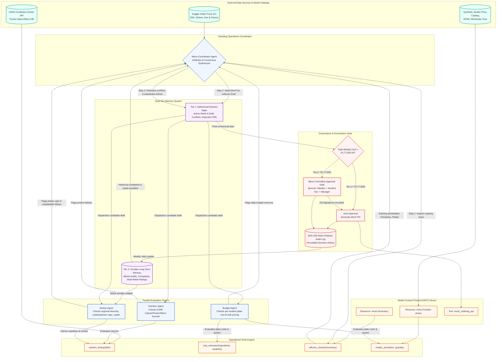

# Hostel Mess Operations Agent - Node Graph & Orchestration Flow

---

## Node Graph Component Interactions

1. **Inventory Pre-computation**: At week start, `leftover_checker` scans the pantry inventory. Perishables with shelf life <= 3 days trigger the Leftover-First heuristic.
2. **Parallel Swarm Evaluation**: The Coordinator broadcasts the candidate draft to `Nutrition-Agent`, `Budget-Agent`, and `Variety-Agent` concurrently.
3. **Multi-Agent Conflict Arbitration**:
   - `Budget-Agent` attempts to minimize costs by maximizing cheap ingredients (potatoes).
   - `Variety-Agent` rejects this via the Max 3 Potato Rule and historical plate-waste penalties.
   - `Nutrition-Agent` demands elevated protein levels.
   - `Menu-Coordinator` reconciles these opposing vectors by selecting protein-dense pulses (Rajma/Moong) that utilize pantry bulk stock.
4. **Governance Ceiling Gate**: If total procurement cost breaches the weekly threshold of **₹5,77,500.00**, automated processing stops. The system enters the Human-in-the-Loop approval gate requiring 2-out-of-3 quorum sign-off from the Mess Warden, Student General Secretary, and Mess Manager.
5. **Cryptographic Audit Log**: Every modification, debate resolution, and approval decision is logged into an immutable SHA-256 hash-chained ledger.
