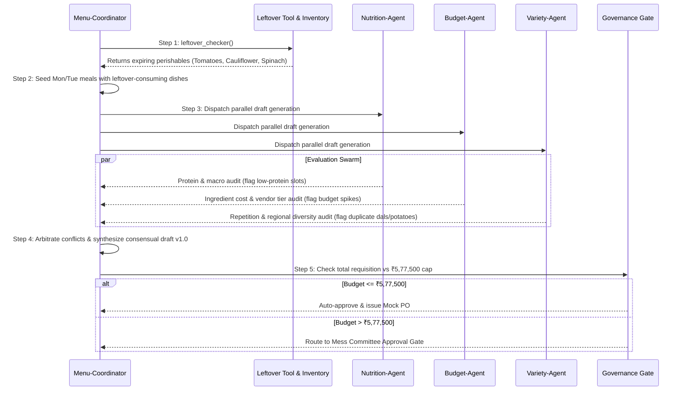

# Weekly Menu Planning Skill

## 1. Operational Objectives
The Weekly Menu Planning Skill guides the standing operations agent through generating, evaluating, and finalizing a 7-day nutritional, cost-efficient, and student-favored hostel mess menu for 500 resident students.

---

## 2. Core Operational Constraints

### A. Nutrition Targets (ICMR Standards per student per day)
- **Daily Calories**: 2,200 – 2,500 kcal
- **Protein Ceiling & Floor**: Minimum 68.0g/day (Target: 70–80g)
  - Must provide high-protein breakfast anchor (sprouts, eggs, paneer, chana)
  - Lunch and dinner must feature at least one rich protein legume or dairy/meat dish
- **Dietary Fiber**: >= 30g/day
- **Fat Cap**: Maximum 65g/day (limit deep-fried snacks to max 2 per week)
- **Micronutrients**: Iron >= 15mg, Calcium >= 600mg

### B. Budget Ceiling
- **Per Student Per Day Cap**: ₹165.00
- **Weekly Mess Allowance (500 students x 7 days)**: **₹5,77,500.00**
- **Monthly Budget Cap**: ₹24,75,000.00
- **Threshold Rule**: Any generated purchase requisition exceeding ₹5,77,500.00 automatically halts automated deployment and enters the `PENDING_COMMITTEE_APPROVAL` human-in-the-loop governance gate.

### C. Leftover-First Rule (Pantry Waste Minimization)
1. Query `leftover_checker(inventory)` at the start of each planning cycle.
2. Any inventory item with `days_to_expiry <= 3` is designated `CRITICAL_LEFTOVER`.
3. **Mandatory Scheduling**: The Menu Coordinator MUST allocate dishes utilizing these expiring items into **Monday Lunch/Dinner or Tuesday Lunch/Dinner**.
4. No new purchase order may be placed for an ingredient category where aging inventory already exists in excess of safety stock.

### D. Variety & Palatability Rules
- **Paneer Cap**: Maximum 2 meals per week (due to cost and dairy rotation).
- **Potato (Aloo) Cap**: Maximum 3 meals per week across mains (prevents student dissatisfaction / carb heaviness).
- **Dal Rotation**: No identical dal on consecutive days (alternate Toor, Chana, Rajma, Moong, Masoor).
- **Regional Balance**:
  - Minimum 2 South Indian breakfasts (Idli/Dosa/Upma)
  - Minimum 3 North Indian meals (Rajma, Paratha, Chole)
  - Inclusion of West & East Indian staples (Poha, Dhokla, Khichdi)
- **Flavor Profile Distribution**: Each day must balance spicy, savory, and cooling/tangy elements (e.g. curd, raita, salad).

---

## 3. Weekly Planning Execution Flow



---

## 4. Standard Output Template

Every finalized planning run MUST produce a structured JSON and Markdown schedule following this template:

```json
{
  "semester_week": 6,
  "execution_timestamp": "2026-09-09T08:00:00Z",
  "schedule": {
    "Monday": {
      "breakfast": {"dish": "Poha with Roasted Peanuts & Tea", "calories": 280, "protein_g": 6.2, "cost_per_plate_inr": 18.5},
      "lunch": {"dish": "Aloo Gobi Matar with Phulka & Dal Tadka", "calories": 520, "protein_g": 18.0, "cost_per_plate_inr": 34.0, "leftover_utilized": ["Cauliflower", "Hybrid Tomatoes"]},
      "snack": {"dish": "Bread Pakoda with Green Chutney", "calories": 330, "protein_g": 7.4, "cost_per_plate_inr": 16.0},
      "dinner": {"dish": "Palak Paneer with Missi Roti & Rice", "calories": 560, "protein_g": 26.5, "cost_per_plate_inr": 52.0, "leftover_utilized": ["Fresh Spinach (Palak)"]}
    }
    // ... repeats for Tuesday through Sunday
  },
  "summary_metrics": {
    "total_weekly_cost_inr": 542300.0,
    "cost_per_student_per_day_inr": 154.94,
    "average_daily_protein_g": 74.2,
    "average_daily_calories": 2360,
    "pantry_leftovers_cleared_kg": 107.0,
    "budget_status": "WITHIN_CEILING",
    "approval_status": "AUTO_APPROVED"
  },
  "procurement_order": [
    {"item": "Atta (Whole Wheat Flour)", "qty": 300, "unit": "kg", "total_inr": 9300.0}
  ]
}
```
